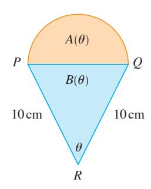
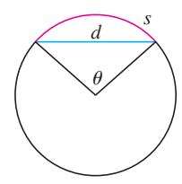
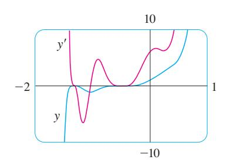
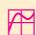
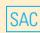
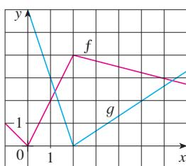
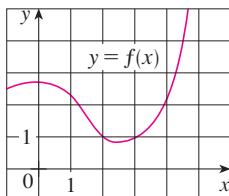
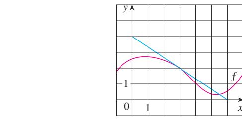
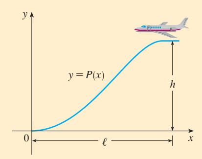

Suponga que se le pide derivar la función

$$F(x) = \sqrt{x^2 + 1}$$

- **38.** Un objeto con peso *W* es arrastrado a lo largo de un plano horizontal, por una fuerza que actúa a lo largo de una cuerda sujeta al objeto. Si la cuerda forma un ángulo . con el plano, entonces la magnitud de la fuerza es

$$F = \frac{\mu W}{\mu \sin \theta + \cos \theta}$$

donde & es una constante llamada *coeficiente de fricción*.

- a) Encuentre la razón de cambio de *F* respecto a ..
- b) ¿Cuándo es igual a 0 esta razón de cambio?
- c) Si *W* m 50 lb y & m 0.6, dibuje la gráfica de *F* como función de . y úsela para localizar el valor de . para el cual *dF*Y*d*. m 0. ¿Resulta coherente el valor con su respuesta al inciso b)?

 **39-48** Determine cada uno de los siguientes límites.

**39.** 
$$\lim_{x \rightarrow 0} \frac{\sec 3x}{x}$$
 40.

**41.** 
$$\lim_{t \rightarrow 0} \frac{\tan 6t}{\sec 2t}$$
 42.

43. 
$$\lim_{x \rightarrow 0} \frac{\text{sen } 3x}{5x^3 - 4x}$$
 44.

**45.** 
$$\lim_{\theta \rightarrow 0} \frac{\text{sen } \theta}{\theta + \tan \theta}$$
 **46.**  $\lim_{x \rightarrow 0} \frac{\text{sen } x}{x}$ 

47. 
$$\lim_{x \rightarrow \pi/4} \frac{1 - \tan x}{\sin x - \cos x}$$
      48.  $\lim_{x \rightarrow 1}$ 

48. 
$$\lim_{x \rightarrow 1} \frac{\sec(x - 1)}{x^2 + x - 2}$$

46. 
$$\lim_{x \rightarrow 0} \frac{\sec(x^2)}{x}$$

$$\lim_{x \rightarrow 0} \frac{\text{sen } 3x}{5x^3 - 4x}$$
      44.  $\lim_{x \rightarrow 0} \frac{\text{sen } 3x \text{ sen } 5x}{x^2}$ 

42. 
$$\lim_{\theta \rightarrow 0} \frac{\cos \theta - 1}{\sec \theta}$$

| $\lim_{x \rightarrow 0}$ | $\frac{\text{sen } 3x}{x}$ | 40. | $\lim_{x \rightarrow 0}$ | $\frac{\text{sen } 4x}{\text{sen } 6x}$ |
|--------------------------|----------------------------|-----|--------------------------|-----------------------------------------|
|                          |                            |     |                          |                                         |

 **49-50** Encuentre la derivada que se muestra, mediante la búsqueda de las primeras derivadas y observando el patrón que aparece.

49. 
$$\frac{d^{99}}{dx^{99}}(\sec x)$$
 50.

$$\frac{d^{99}}{dx^{99}}(\text{sen } x) = 50. \quad \frac{d^{35}}{dx^{35}}(x \text{ sen } x)$$

- **51.** Encuentre constantes *A* y *B* tales que la función *y* m *A* sen *x B* cos *x* satisface la ecuación diferencial *y y* 2*y* m sen *x*.

**52. a)** Evalúe 
$$\lim_{x \rightarrow \infty} x \sec \frac{1}{x}$$
.

b) Evalúe 
$$\lim_{x \rightarrow 0} x \sec \frac{1}{x}$$
.

- c) Ilustre los incisos a) y b) graficando *y* m *x* sen(1Y*x*).

- **53.** Derive cada una de las siguientes identidades trigonométricas para obtener una identidad nueva (o conocida) .

a) 
$$\tan x = \frac{\sec x}{\cos x}$$
      b)  $\sec x = \frac{1}{\cos x}$ 
c)  $\sec x + \cos x = \frac{1 + \cot x}{\csc x}$ 

- **54.** Un semicírculo con diámetro *PQ* descansa sobre un triángulo isósceles *PQR* para configurar una región en forma de cono para helados como el que se ilustra en la figura. Si *A*(.) es el área del semicírculo y *B*(.) es el área del triangulo, halle

$$\lim_{\theta \rightarrow 0^+} \frac{A(\theta)}{B(\theta)}$$

- **55.** En la figura se muestra un arco circular de longitud *s* y una cuerda de longitud *d*, los dos están subtendidos por un ángulo central .. Encuentre

$$\lim_{\theta \rightarrow 0^+} \frac{s}{d}$$

6. Sea 
$$f(x) = \frac{x}{\sqrt{1 - \cos 2x}}$$
.

- a) Grafique *f*. ¿Qué tipo de discontinuidad parece tener en *x* m 0?
- b) Calcule los límites por la izquierda y por la derecha en *x* m 0. ¿Confirman estos valores su respuesta al inciso a)?

# **3.4 Regla de la cadena**

Observe que *F* es una función compuesta. De hecho, si hacemos *y fu* s*u* y *u* m J(*x*) m *x*2 1, entonces podemos escribir *y* m *F*(*x*) m *f* (J(*x*)); es decir, *F* m *f* J. Sabemos cómo derivar tanto *f* como J, de modo que sería útil contar con una regla que nos indique cómo hallar la derivada de *F* m *f* J en términos de las derivadas de *f* y J.

Resulta que la derivada de la función compuesta *f* J es el producto de las derivadas de *f* y J. Este hecho es uno de los más importantes de las reglas de derivación y se llama *regla de la cadena*. Esto parece verosímil si interpretamos las derivadas como razones de cambio. Consideremos *du*Y*dx* como la razón de cambio de *u* respecto a *x*, *dy*Y*du* como la razón de cambio de *y* respecto a *u*, y *dy*Y*dx* como la razón de cambio de *y* respecto a *x*. Si *u* cambia al doble de rapidez de *x* y *y* varía tres veces más rápido que *u*, entonces parece razonable que *y* se modifique seis veces más rápido que *x*, y, por tanto, esperamos que

$$\frac{dy}{dx} = \frac{dy}{du} \frac{du}{dx}$$

Véase la sección 1.3 para un repaso de funciones compuestas.

> **Regla de la cadena** *Si* J es derivable en *x* y *f* es derivable en J(*x*), entonces la función compuesta *F* m *f* J definida mediante *F*(*x*) m *f* (J(*x*)) es derivable en *x*, y *F* está dada por el producto

$$F'(x) = f'(g(x)) \cdot g'(x)$$

En la notación de Leibniz, si *y* m *f* (*u*) y *u* m J(*x*) son funciones derivables, entonces

$$\frac{dy}{dx} = \frac{dy}{du} \frac{du}{dx}$$

COMENTARIOS SOBRE LA DEMOSTRACIÓN DE LA REGLA DE LA CADENA Sea \$*u* el cambio en *u* correspondiente a un cambio de \$*x* en *x*; es decir,

$$\Delta u = g(x + \Delta x) - g(x)$$

Entonces el cambio correspondiente en *y* es

$$\Delta y = f(u + \Delta u) - f(u)$$

Resulta tentador escribir

$$\begin{aligned} \frac{dy}{dx} &= \frac{\text{lim}_{\Delta x \rightarrow 0}}{\Delta x} \frac{\Delta y}{\Delta x} \\ &= \frac{\text{lim}_{\Delta x \rightarrow 0}}{\Delta x} \frac{\Delta y}{\Delta x} \cdot \frac{\Delta u}{\Delta x} \\ &= \frac{\text{lim}_{\Delta x \rightarrow 0}}{\Delta x} \frac{\Delta y}{\Delta u} \cdot \frac{\text{lim}_{\Delta x \rightarrow 0}}{\Delta x} \frac{\Delta u}{\Delta x} \\ &= \frac{\text{lim}_{\Delta u \rightarrow 0}}{\Delta u} \frac{\Delta y}{\Delta u} \cdot \frac{\text{lim}_{\Delta x \rightarrow 0}}{\Delta x} \frac{\Delta u}{\Delta x} \\ &\quad (\text{Advierta que } \Delta u \rightarrow 0 \text{ conforme } \Delta x \rightarrow 0 \text{ porque } g \text{ es continua.}) \\ &= \frac{dy}{du} \frac{du}{dx} \end{aligned}$$

### **James Gregory**

El primero en formular la regla de la cadena fue el matemático escocés James Gregory (1638-1675), quien también diseñó el primer telescopio práctico. Gregory descubrió las ideas básicas del Cálculo en la misma época que Newton. Se convirtió en el primer profesor de Matemáticas en la Universidad de St. Andrews y más tarde realizó la misma actividad en la Universidad de Edimburgo. Pero un año después de aceptar ese cargo, falleció a la edad de 36 años.

El único defecto de este razonamiento es que en 1 podría suceder que \$*u* m 0 (aun cuando \$*x* 0) y, por supuesto, no podemos dividir entre 0. No obstante, este razonamiento *sugiere* por lo menos que la regla de la cadena es verdadera. Al final de esta sección se da una demostración completa de la regla de la cadena.

La regla de la cadena puede escribirse con apóstrofos

2

$$(f \circ g)'(x) = f'(g(x)) \cdot g'(x)$$

o bien, si *y* m *f* (*u*) *y u* m J(*x*), en la notación de Leibniz:

$$\frac{dy}{dx} = \frac{dy}{du} \frac{du}{dx}$$

**3**

La ecuación 3 es fácil de recordar porque si *dy*Y*du* y *du*Y*dx* fueran cocientes, entonces podría cancelar *du*. Sin embargo, recuerde que *du* no se ha definido y no debe concebir *du*Y*dx* realmente como un cociente.

 **EJEMPLO 1** Encuentre *F*(*x*) si *F x* s*x* 2 1.

SOLUCIÓN 1 (Utilizando la ecuación 2): Al principio de esta sección, expresamos *F* como *F*(*x*) m ( *f* J)(*x*) m *f* (J(*x*)) donde *f u* s*u* y J(*x*) m *x*2 1. Dado que

| $f'(u) = \frac{1}{2}u^{-1/2} = \frac{1}{2\sqrt{u}}$ | $y$ | $g'(x) = 2x$ |
|-----------------------------------------------------|-----|--------------|
|-----------------------------------------------------|-----|--------------|

$$F'(x) = f'(g(x)) \cdot g'(x)$$

tenemos

$$\begin{aligned} F'(x) &= f'(g(x)) \cdot g'(x) \\ &= \frac{1}{2\sqrt{x^2 + 1}} \cdot 2x = \frac{x}{\sqrt{x^2 + 1}} \end{aligned}$$

SOLUCIÓN 2 (Utilizando la ecuación 3): Si hacemos *u* m *x*2 1 y *y* s*u* , entonces

$$F'(x) = \frac{dy}{dx} \frac{dx}{dx} = \frac{1}{2\sqrt{u}}(2x) = \frac{1}{2\sqrt{x^2+1}}(2x) = \frac{x}{\sqrt{x^2+1}}$$

Al utilizar la fórmula 3, debemos tener presente que *dy*Y*dx* se refiere a la derivada de *y* cuando ésta se considera como función de *x* (llamada *derivada de y respecto a x*), en tanto que *dy*Y*du* se refiere a la derivada de *y* cuando se considera como función de *u* (la derivada de *y* respecto a *u*). Por tanto, en el ejemplo 1, *y* puede considerarse como función de ( *y* s*x* 2 *x* 1) y también como una función de *u* ( *y* s*u* ). Observe que

$$\frac{dy}{dx} = F'(x) = \frac{x}{\sqrt{x^2 + 1}} \quad \text{mientras que} \quad \frac{dy}{du} = f'(u) = \frac{1}{2\sqrt{u}}$$

**NOTA** En la aplicación de la regla de la cadena, trabajamos del exterior hacia el interior. La fórmula 2 expresa que *derivamos la función exterior f* [*en la función interior* J(*x*)] *y*, *a continuación*, *multiplicamos por la derivada de la función interior*.

| $\frac{d}{dx}$ | $f$              | $(g(x))$                        | $=$ | $f'$                            | $(g(x))$                        | $\cdot$ | $g'(x)$                         |
|----------------|------------------|---------------------------------|-----|---------------------------------|---------------------------------|---------|---------------------------------|
|                | función exterior | evaluada en la función interior |     | derivada de la función exterior | evaluada en la función interior |         | derivada de la función interior |

**v EJEMPLO 2** Derive a) *y* m sen(*x*2 ) y b) *y* m sen2 *x*.

### SOLUCIÓN

a) Si *y* m sen(*x*2 ), entonces la función exterior es la función seno, y la interior es la función elevar al cuadrado, de modo que la regla de la cadena da

$$\frac{dy}{dx} = \frac{d}{dx} \underbrace{\text{sen}}_{\substack{\text{función} \\ \text{exterior}}} \underbrace{(x^2)}_{\substack{\text{evaluada en} \\ \text{la función} \\ \text{interior}}} = \underbrace{\cos}_{\substack{\text{derivada de} \\ \text{la función} \\ \text{exterior}}} \underbrace{(x^2)}_{\substack{\text{evaluada en} \\ \text{la función} \\ \text{interior}}} \cdot \underbrace{2x}_{\substack{\text{derivada de} \\ \text{la función} \\ \text{interior}}}$$

b) Observe que sen2 *x* m (sen *x*)2 . En este caso, la función exterior es la de elevar al cuadrado, y la interior es la función seno. Por tanto,

$$\frac{dy}{dx} = \frac{d}{dx} (\underbrace{\text{sen } x^2}_{\text{función interior}}) = \underbrace{2}_{\text{derivada de la función exterior}} \cdot \underbrace{(\text{sen } x)}_{\text{evaluada en la función interior}} \cdot \underbrace{\cos x}_{\text{derivada de la función interior}}$$

La respuesta puede dejarse como 2 sen *x* cos *x*, o bien, escribirse como sen 2*x* (por una identidad trigonométrica conocida como fórmula del ángulo doble).

En el ejemplo 2a), combinamos la regla de la cadena con la regla para derivar la función seno. En general, si *y* m sen *u*, donde *u* es una función derivable de *x*, entonces, por la regla de la cadena,

$$\frac{dy}{dx} = \frac{dy}{du} \frac{du}{dx} = \cos u \frac{du}{dx}$$

Así que

$$\frac{d}{dx}(\sin u) = \cos u \frac{du}{dx}$$

De modo semejante, todas las fórmulas para derivar funciones trigonométricas pueden combinarse con la regla de la cadena.

Hagamos explícito el caso especial de la regla de la cadena donde la función exterior *f* es una función potencia. Si *y* m FJ(*x*)G*n* , entonces podemos escribir *y* m *f* (*u*) m *un* , donde *u* m J(*x*). Si aplicamos la regla de la cadena y, a continuación, la regla de la potencia, entonces

$$\frac{dy}{dx} = \frac{dy}{du} \frac{du}{dx} = nu^{n-1} \frac{du}{dx} = n[g(x)]^{n-1}g'(x)$$

Véase la página de referencia 2 o el apéndice D.

**4 Regla de la potencia combinada con la regla de la cadena** Si *n* es cualquier número real y *u* m J(*x*) es derivable, entonces

$$\frac{d}{dx}(u^n) = nu^{n-1} \frac{du}{dx}$$

De modo alternativo,

$$\frac{d}{dx} [g(x)]^n = n[g(x)]^{n-1} \cdot g'(x)$$

 **EJEMPLO 3** Derive *y* m (*x*3 1)100.

SOLUCIÓN Si, en 4 , se toman *u* m J(*x*) m *x*3 1 y *n* m 100, tenemos que

$$\begin{aligned} \frac{dy}{dx} &= \frac{d}{dx} (x^3 - 1)^{100} = 100(x^3 - 1)^{99} \frac{d}{dx} (x^3 - 1) \\ &= 100(x^3 - 1)^{99} \cdot 3x^2 = 300x^2(x^3 - 1)^{99} \end{aligned}$$

**VEJEMPLO 4** Encuentre 
$$f'(x)$$
 si  $f(x) = \frac{1}{\sqrt[3]{x^2 + x + 1}}$ .

SOLUCIÓN En primer lugar, reescribimos *f* como: *f* (*x*) m (*x*2 *x* 1)1Y3

|                                                       |                                                                                                            |  |
|--------------------------------------------------------------------|------------------------------------------------------------------------------------------------------------|---------------|
| 
De este modo
                                            | 
<math display="block">f'(x) = -\frac{1}{3}(x^2 + x + 1)^{-4/3} \frac{d}{dx}(x^2 + x + 1)</math>
 |               |
|                                                                    |                                                                                                            |               |
| 
<math>= -\frac{1}{3}(x^2 + x + 1)^{-4/3}(2x + 1)</math>
 |                                                                                                            |               |

 **EJEMPLO 5** Encuentre la derivada de la función

$$g(t) = \left( \frac{t - 2}{2t + 1} \right)^9$$

SOLUCIÓN Si se combinan la regla de la potencia, la regla de la cadena y la regla del cociente, obtenemos

$$\begin{aligned} g'(t) &= 9 \left( \frac{t-2}{2t+1} \right)^8 \frac{d}{dt} \left( \frac{t-2}{2t+1} \right) \\ &= 9 \left( \frac{t-2}{2t+1} \right)^8 \frac{(2t+1) \cdot 1 - 2(t-2)}{(2t+1)^2} = \frac{45(t-2)^8}{(2t+1)^{10}} \end{aligned}$$

 **EJEMPLO 6** Derive *y* m (2*x* 1)5 (*x*3 *x* 1)4 .

SOLUCIÓN En este ejemplo debemos aplicar la regla del producto antes de aplicar la regla de la cadena:

$$\begin{aligned} \frac{dy}{dx} &= (2x + 1)^5 \frac{d}{dx} (x^3 - x + 1)^4 + (x^3 - x + 1)^4 \frac{d}{dx} (2x + 1)^5 \\ &= (2x + 1)^5 \cdot 4(x^3 - x + 1)^3 \frac{d}{dx} (x^3 - x + 1) \\ &\quad + (x^3 - x + 1)^4 \cdot 5(2x + 1)^4 \frac{d}{dx} (2x + 1) \\ &= 4(2x + 1)^5 (x^3 - x + 1)^3 (3x^2 - 1) + 5(x^3 - x + 1)^4 (2x + 1)^4 \cdot 1 \end{aligned}$$

Observe que cada término tiene el factor común 2(2*x* 1)4 (*x*3 *x* 1)3 , así que podemos factorizarlo y escribir la respuesta como

$$\frac{dy}{dx} = 2(2x + 1)^4(x^3 - x + 1)^3(17x^3 + 6x^2 - 9x + 3)$$

**FIGURA 1**

En la figura 1 se muestran las gráficas de las funciones *y* y *y* del ejemplo 6. Observe que *y* es grande cuando *y* crece con rapidez, y *y* m 0 cuando *y* tiene una recta tangente horizontal. De modo que la respuesta parece ser razonable.

SOLUCIÓN En este caso la función interior es J(*x*) m sen *x*, y la exterior es la función exponencial *f* (*x*) m *e x* . Por tanto, por la regla de la cadena,

$$\frac{dy}{dx} = \frac{d}{dx} (e^{\text{sen }x}) = e^{\text{sen }x} \frac{d}{dx} (\text{sen }x) = e^{\text{sen }x} \cos x$$

Podemos aplicar la regla de la cadena para derivar una función exponencial con cualquier base *a* 0. Recuerde, por lo visto en la sección 1.6, que *a* m *e* ln *a* . De este modo,

$$a^x = (e^{\ln a})^x = e^{(\ln a)x}$$

y la regla de la cadena da

$$\begin{aligned} \frac{d}{dx} (a^x) &= \frac{d}{dx} (e^{(\ln a)x}) = e^{(\ln a)x} \frac{d}{dx} (\ln a)^x \\ &= e^{(\ln a)x} \cdot \ln a = a^x \ln a \end{aligned}$$

porque ln *a* es una constante. En consecuencia, tenemos la fórmula

| 
5
 

 | 
<math display="block">\frac{d}{dx}(a^x) = a^x \ln a</math>
 |
|--------------------------|-----------------------------------------------------------------------|
|--------------------------|-----------------------------------------------------------------------|

En particular, si *a* m 2, obtenemos

$$\boxed{6} \quad \frac{d}{dx}(2^x) = 2^x \ln 2$$

En la sección 3.1, dimos la estimación

$$\frac{d}{dx}(2^x) \approx (0.69)2^x$$

Esto resulta coherente con la fórmula exacta 6 porque ln 2 y 0.693147.

La razón para el nombre "regla de la cadena" queda clara cuando se ve como analogía de agregar eslabones para alargar una cadena. Supongamos que *y* m *f* (*u*), *u* m J(*x*) y *x* m *h*(*t*), donde *f*, J y *h* son funciones derivables. Entonces, para calcular la derivada de *y* respecto a *t*, utilizamos dos veces la regla de la cadena:

$$\frac{dy}{dt} = \frac{dy}{dx} \frac{dx}{dt} = \frac{dy}{du} \frac{du}{dx} \frac{dx}{dt}$$

**v EJEMPLO 8** Si *f* (*x*) m sen(cos(tan *x*)), entonces

$$\begin{aligned} f'(x) &= \cos(\cos(\tan x)) \frac{d}{dx} \cos(\tan x) \\ &= \cos(\cos(\tan x)) [-\text{sen}(\tan x)] \frac{d}{dx} (\tan x) \\ &= -\cos(\cos(\tan x)) \text{sen}(\tan x) \sec^2 x \end{aligned}$$

Más generalmente, la regla de la cadena da:

$$\frac{d}{dx}(e^u) = e^u \frac{du}{dx}$$

No confunda la fórmula 5 (donde *x* es el exponente) con la regla de la potencia (donde *x* es la base):

$$\frac{d}{dx}(x^n) = nx^{n-1}$$

SOLUCIÓN La función exterior es la función exponencial, la función media es la función secante y la función interna es el triple de la función. De modo que

$$\begin{aligned} \frac{dy}{d\theta} &= e^{\sec 3\theta} \frac{d}{d\theta} (\sec 3\theta) \\ &= e^{\sec 3\theta} \sec 3\theta \tan 3\theta \frac{d}{d\theta} (3\theta) \\ &= 3e^{\sec 3\theta} \sec 3\theta \tan 3\theta \end{aligned}$$

## **Cómo demostrar la regla de la cadena**

Recuerde que si *y* m *f* (*x*) y *x* cambia de *a* a *a* \$*x*, se define el incremento de *y* como

$$\Delta y = f(a + \Delta x) - f(a)$$

Según la definición de derivada, tenemos que

$$\lim_{\Delta x \rightarrow 0} \frac{\Delta y}{\Delta x} = f'(a)$$

Por consiguiente, si denotamos por medio de el cociente de diferencias y la derivada, obtenemos

$$\lim_{\Delta x \rightarrow 0} \varepsilon = \lim_{\Delta x \rightarrow 0} \left( \frac{\Delta y}{\Delta x} - f'(a) \right) = f'(a) - f'(a) = 0$$

| pero | $\varepsilon = \frac{\Delta y}{\Delta x} - f'(a)$ | $\Rightarrow$ | $\Delta y = f'(a) \Delta x + \varepsilon \Delta x$ |
|------|---------------------------------------------------|---------------|----------------------------------------------------|
|------|---------------------------------------------------|---------------|----------------------------------------------------|

Si definimos como 0 cuando \$*x* m 0, entonces se convierte en función continua de \$*x*. De esta manera, para una función *f* derivable, podemos escribir

| $[7]$ | $\Delta y = f'(a) \Delta x + \varepsilon \Delta x$ | donde | $\varepsilon \rightarrow 0$ cuando $\Delta x \rightarrow 0$ |
|-------|----------------------------------------------------|-------|-------------------------------------------------------------|
|       |                                                    |       |                                                             |

y es una función continua de \$*x*. Esta propiedad de las funciones derivables es lo que permite demostrar la regla de la cadena.

DEMOSTRACIÓN DE LA REGLA DE LA CADENA Suponga que *u* m J(*x*) es derivable en *x* m *a* y *y* m *f* (*u*) es derivable en *b* m J(*a*). Si \$*x* es un incremento en *x*, y \$*u* y \$*y* son los incrementos correspondientes en *u* y *y*, entonces podemos aplicar la ecuación 7 para escribir

$$\Delta u = g'(a) \Delta x + \varepsilon_1 \Delta x = [g'(a) + \varepsilon_1] \Delta x$$

donde 1 l 0 conforme \$*x* l 0. De manera análoga,

$$\Delta y = f'(b) \Delta u + \varepsilon_2 \Delta u = [f'(b) + \varepsilon_2] \Delta u$$

donde 2 l 0 conforme \$*u* l 0. Si ahora sustituimos la expresión para \$*u* de la ecuación 8 en la ecuación 9, obtenemos

$$\Delta y = [f'(b) + \varepsilon_2][g'(a) + \varepsilon_1] \Delta x$$

así que

$$\frac{\Delta y}{\Delta x} = [f'(b) + \varepsilon_2][g'(a) + \varepsilon_1]$$

A medida que  $\Delta x \rightarrow 0$ , la ecuación 8 muestra que  $\Delta u \rightarrow 0$ . De modo que tanto  $\varepsilon_1 \rightarrow 0$  y  $\varepsilon_2 \rightarrow 0$  conforme  $\Delta x \rightarrow 0$ . Debido a eso

$$\begin{aligned} \frac{dy}{dx} &= \lim_{\Delta x \rightarrow 0} \frac{\Delta y}{\Delta x} = \lim_{\Delta x \rightarrow 0} [f'(b) + \varepsilon_2][g'(a) + \varepsilon_1] \\ &= f'(b)g'(a) = f'(g(a))g'(a) \end{aligned}$$

Esto demuestra la regla de la cadena.

### 3.4 Ejercicios

**1-6** Escriba la función compuesta en la forma  $f(g(x))$ . [Identifique la función interior  $u = g(x)$  y la exterior  $y = f(u)$ ]. Luego, encuentre la derivada  $dy/dx$  de cada una de las siguientes funciones.

| 1. $y = \sqrt[3]{1 + 4x}$ | 2. $y = (2x^3 + 5)^4$       |
|---------------------------|-----------------------------|
| 3. $y = \tan \pi x$       | 4. $y = \text{sen}(\cot x)$ |
| 5. $y = e^{\sqrt{x}}$     | 6. $y = \sqrt{2 - e^x}$     |

**7-46** Obtenga la derivada de cada una de las siguientes funciones.

| 7. $F(x) = (x^4 + 3x^2 - 2)^5$                   | 8. $F(x) = (4x - x^2)^{100}$                     |
|--------------------------------------------------|--------------------------------------------------|
| 9. $F(x) = \sqrt{1 - 2x}$                        | 10. $f(x) = \frac{1}{(1 + \sec x)^2}$            |
| 11. $f(z) = \frac{1}{z^2 + 1}$                   | 12. $f(t) = \text{sen}(e^t) + e^{\text{sen } t}$ |
| 13. $y = \cos(a^3 + x^3)$                        | 14. $y = a^3 + \cos^3 x$                         |
| 15. $y = xe^{-kx}$                               | 16. $y = e^{-2t} \cos 4t$                        |
| 17. $f(x) = (2x - 3)^4(x^2 + x + 1)^5$           |                                                  |
| 18. $g(x) = (x^2 + 1)^3(x^2 + 2)^6$              |                                                  |
| 19. $h(t) = (t + 1)^{2/3}(2t^2 - 1)^3$           |                                                  |
| 20. $F(t) = (3t - 1)^4(2t + 1)^{-3}$             |                                                  |
| 21. $y = \left(\frac{x^2 + 1}{x^2 - 1}\right)^3$ | 22. $f(s) = \sqrt{\frac{s^2 + 1}{s^2 + 4}}$      |
| 23. $y = \sqrt{1 + 2e^{3x}}$                     | 24. $y = 10^{1-x^2}$                             |
| 25. $y = 5^{-1/x}$                               | 26. $G(y) = \frac{(y - 1)^4}{(y^2 + 2y)^5}$      |
| 27. $y = \frac{r}{\sqrt{r^2 + 1}}$               | 28. $y = \frac{e^u - e^{-u}}{e^u + e^{-u}}$      |
| 29. $F(t) = e^{t \cdot \text{sen } 2t}$          | 30. $F(v) = \left(\frac{v}{v^3 + 1}\right)^6$    |
| 31. $y = \text{sen}(\tan 2x)$                    | 32. $y = \sec^2(m\theta)$                        |

| 33. $y = 2^{\text{sen } \pi x}$                          | 34. $y = x^2 e^{-1/x}$                          |
|----------------------------------------------------------|-------------------------------------------------|
| 35. $y = \cos\left(\frac{1 - e^{2x}}{1 + e^{2x}}\right)$ | 36. $y = \sqrt{1 + xe^{-2x}}$                   |
| 37. $y = \cot^2(\text{sen } \theta)$                     | 38. $y = e^{k \tan \sqrt{x}}$                   |
| 39. $f(t) = \tan(e^t) + e^{\tan t}$                      | 40. $y = \text{sen}(\text{sen}(\text{sen } x))$ |
| 41. $f(t) = \text{sen}^2(e^{\text{sen } 2t})$            | 42. $y = \sqrt{x + \sqrt{x + \sqrt{x}}}$        |
| 43. $g(x) = (2ra^{rx} + n)^p$                            | 44. $y = 2^{3x^2}$                              |
| 45. $y = \cos \sqrt{\text{sen}(\tan \pi x)}$             | 46. $y = [x + (x + \text{sen } x)^3]^4$         |

**47-50** Encuentre la primera y segunda derivadas de cada una de las siguientes funciones:

| 47. $y = \cos(x^2)$                        | 48. $y = \cos^2 x$ |
|--------------------------------------------|--------------------|
| 49. $y = e^{\alpha x} \text{sen } \beta x$ | 50. $y = e^{e^x}$  |

**51-54** Encuentre la ecuación de la recta tangente a la curva en el punto dado.

| 51. $y = (1 + 2x)^{10}$ , $(0, 1)$               | 52. $y = \sqrt{1 + x^3}$ , $(2, 3)$                  |
|--------------------------------------------------|------------------------------------------------------|
| 53. $y = \text{sen}(\text{sen } x)$ , $(\pi, 0)$ | 54. $y = \text{sen } x + \text{sen } x^2$ , $(0, 0)$ |

- **58.** La función *f* (*x*) m sen(*x* sen 2*x*), 0 v *x* v ), surge en aplicaciones a la sintonía de frecuencia modulada (FM).
- a) Utilice una gráfica de *f* producida por un dispositivo de graficación para trazar un boceto aproximado de la gráfica de *f*.
- b) Calcule *f*(*x*) y utilice esta expresión, junto con un dispositivo graficador, para graficar *f*. Compare con su boceto del inciso a).
- **59.** Encuentre todos los puntos sobre la gráfica de la función *f* (*x*) m 2 sen *x* sen2 *x* en los cuales la recta tangente es horizontal.
- **60.** Determine las coordenadas *x* de todos los puntos de la curva *y* m sen 2*x* 2 sen *x* en los cuales la recta tangente es horizontal.
- **61.** Si *F*(*x*) m *f* (J(*x*)), donde *f* (2) m 8, *f*(2) m 4, *f*(5) m 3, J(5) m 2, y J(5) m 6, halle *F*(5).
- **62.** Si *h x* s4 3*f x* , donde *f* (1) m 7 y *f*(1) m 4, halle *h*(1).
- **63.** Se da una tabla de valores de *f*, J, *f* y J

| x | f x | t x | f x | t x |
|---|-----|-----|-----|-----|
| 1 | 3   | 2   | 4   | 6   |
| 2 | 1   | 8   | 5   | 7   |
| 3 | 7   | 2   | 7   | 9   |

 a) Si *h*(*x*) m *f* (J(*x*)), encuentre *h*(1). b) Si *H*(*x*) m J( *f* (*x*)), halle *H*(1).  **64.** Sean *f* y J las funciones del ejercicio 63. a) Si *F*(*x*) m *f* ( *f* (*x*)), encuentre *F*(2). b) Si *G*(*x*) m J(J(*x*)), encuentre *G*(3).

**65.** Sean *f* y J las funciones cuyas gráficas se muestran; sea

*u*(*x*) m *f* (J(*x*)), *v*(*x*) m J( *f* (*x*)) y *w*(*x*) m J(J(*x*)). Encuentre, si existe, cada derivada. Si no existe, explique por qué.

a) *u*(1) b) *v*(1) c) *w*(1)

- **66.** Si *f* es la función cuya gráfica se muestra, sea *h*(*x*) m *f* (*f* (*x*)) y J(*x*) m *f* (*x*2 ). Utilice la gráfica de *f* para estimar el valor de cada derivada.
- a) *h*(2) b) J(2)

- **67.** Si t *x* s*f x* , donde *f* es la gráfica que se muestra, evalúe J(3).

- **68.** Suponga que *f* es derivable sobre 2 y es un número real. Sea *F*(*x*) m *f* (*x* ) y *G*(*x*) m F *f* (*x*)G . Encuentre expresiones para a) *F*(*x*) y b) *G*(*x*).
- **69.** Suponga que *f* es derivable sobre 2. Sea *F*(*x*) m *f* (*e x* ) y *G*(*x*) m *e f* (*x*) . Encuentre expresiones para a) *F*(*x*) y
  - b) *G*(*x*).
- **70.** Sea J(*x*) m *e cx f* (*x*) y *h*(*x*) m *ekx f* (*x*), donde *f* (0) m 3, *f*(0) m 5, y *f* (0) m 2.
- a) Encuentre J(0)y J (0) en términos de *c*.
- b) En términos de *k*, encuentre la ecuación de la recta tangente a la gráfica de *h* en el punto donde *x* m 0.
- **71.** Si *r*(*x*) m *f* (J(*h*(*x*))), donde *h*(1) m 2, J(2) m 3, *h*(1) m 4, J(2) m 5 y *f* (3) m 6, encuentre *r*(1).
- **72.** Si J es una función dos veces derivable y *f* (*x*) m *x*J(*x*2 ), halle *f* en términos de J, J y J .
- **73.** Si *F*(*x*) m *f* (3 *f* (4 *f* (*x*))), donde *f* (0) m 0 y *f*(0) m 2, encuentre *F*(0).
- **74.** Si *F*(*x*) m *f* (*x f* (*x f* (*x*))), donde *f* (1) m 2, *f* (2) m 3, *f*(1) m 4, *f*(2) m 5 y *f*(3) m 6, halle *F*(1).
- **75.** Demuestre que la función *y* m *e* 2*x* (*A* cos 3*x B* sen 3*x*) satisface la ecuación diferencial *y* 4*y* 13*y* m 0.
- **76.** ¿Para qué valores de *r* la función *y* m *erx* satisface la ecuación diferencial *y* 4*y y* m 0?
- **77.** Encuentre la 50a. derivada de *y* m cos 2*x*.
- **78.** Encuentre la 1000a. derivada de *f* (*x*) m *xex*
- **79.** El desplazamiento de una partícula sobre una cuerda vibrante está dada por la ecuación *s t* 10 1 4 sen 10 *t* , donde *s* se mide en centímetros y *t* en segundos. Encuentre la velocidad de la partícula después de *t* segundos.
- **80.** Si la ecuación del movimiento de una partícula está dada por *s* m *A* cos(/*t* ), se dice que la partícula describe un *movimiento armónico simple*.
- a) Encuentre la velocidad de la partícula en el instante *t*.
- b) ¿Cuándo es 0 la velocidad?
- **81.** Cefeida, una estrella variable, tiene una brillantez que aumenta y disminuye de manera alternada. La estrella de ese tipo más visible es Delta Cefeida, para la cual el intervalo entre los momentos de máxima brillantez es de 5.4 días. La brillantez promedio de esta estrella es de 4.0, y cambia en 0.35. En vista de estos datos, la brillantez de Delta

Cephei en el tiempo *t*, medido en días, se ha modelado mediante la función

$$B(t) = 4.0 + 0.35 \operatorname{sen}\left(\frac{2\pi t}{5.4}\right)$$

- a) Halle la razón de cambio de la brillantez después de *t* días.
- b) Encuentre, con una aproximación de dos cifras decimales, la razón de aumento después de un día.

- **82.** En el ejemplo 4 de la sección 1.3, obtuvimos un modelo para la duración de la luz diurna (en horas) en Filadelfia en el *t*-ésimo día del año

$$L(t) = 12 + 2.8 \operatorname{sen}\left[\frac{2\pi}{365}(t - 80)\right]$$

 Utilice este modelo para comparar cómo aumentan las horas de luz diurna en Filadelfia el 21 de marzo y el 21 de mayo.

- **83.** El movimiento de un resorte que se somete a una fuerza de fricción o una fuerza de amortiguamiento (como un amortiguador en un automóvil) se modela a menudo mediante el producto de una función exponencial y una función seno o coseno. Suponga que la ecuación del movimiento de un punto sobre tal resorte es

$$s(t) = 2e^{-1.5t} \operatorname{sen} 2\pi t$$

 donde *s* se mide en centímetros y *t* en segundos. Encuentre la velocidad después que transcurren *t* segundos y grafique las funciones de posición y de velocidad para 0 v *t* v 2.

- **84.** En ciertas circunstancias, un rumor se esparce según la ecuación

$$p(t) = \frac{1}{1 + ae^{-kt}}$$

 donde *p*(*t*) es la proporción de la población que lo conoce en el tiempo *t*, y *a* y *k* son constantes positivas. [En la sección 9.4 veremos que ésta es una ecuación razonable para *p*(*t*).] a) Encuentre lím *t*l @ *p*(*t*).

- b) Halle la rapidez de esparcimiento del rumor.
- c) Grafique *p* para el caso en que *a* m 10, *k* m 0.5, con *t* medido en horas. Utilice la gráfica para estimar cuánto tiempo transcurrirá para que 80% de la población escuche el rumor.

- **85.** Una partícula se mueve a lo largo de una línea recta con desplazamiento *s*(*t*), velocidad *v*(*t*) y aceleración *a*(*t*). Demuestre que

$$a(t) = v(t) \frac{dv}{ds}$$

 Explique la diferencia entre los significados de las derivadas *dv*Y*dt* y *dv*Y*ds*.

- **86.** Se bombea aire dentro de un globo esférico para el clima. En cualquier tiempo *t*, el volumen del globo es *V*(*t*), y su radio es *r* (*t*).
- a) ¿Qué representan las derivadas *dV*Y*dr* y *dV*Y*dt*?
- b) Exprese *dV*Y*dt* en términos de *dr*Y*dt*.
- **87.** El flash (unidad de destello) de una cámara funciona mediante el almacenamiento de carga en un capacitor y su liberación

repentina cuando se activa el obturador. Los datos siguientes describen la carga que queda en el capacitor (en microcoulombs, &C) en el instante *t* (en segundos).

| <i>t</i> | 0.004  | 0.02  | 0.04  | 0.06  | 0.08  | 0.10  |
|----------|--------|-------|-------|-------|-------|-------|
| <i>Q</i> | 100.00 | 81.87 | 67.03 | 54.88 | 44.93 | 36.76 |

- a) Halle, usando una calculadora graficadora o una computadora, un modelo exponencial para la carga.
- b) La derivada *Q*(*t*) representa la corriente eléctrica (en microamperes, &A) que fluye del capacitor hacia el bulbo de la lámpara de destello. Con el resultado del inciso a), estime la corriente cuando *t* m 0.04 s. Compare la respuesta con el resultado del ejemplo 2 de la sección 2.1.

- **88.** En la tabla se da la población de estadounidenses, desde 1790 hasta 1860.

| Año  |   |     | Población | Año  |    |     | Población |
|------|---|-----|-----------|------|----|-----|-----------|
| 1790 | 3 | 929 | 000       | 1830 | 12 | 861 | 000       |
| 1800 | 5 | 308 | 000       | 1840 | 17 | 063 | 000       |
| 1810 | 7 | 240 | 000       | 1850 | 23 | 192 | 000       |
| 1820 | 9 | 639 | 000       | 1860 | 31 | 443 | 000       |

- a) Use una calculadora graficadora o una computadora para ubicar los datos con una función exponencial. Dibuje los puntos correspondientes a los datos y el modelo exponencial. ¿Qué tan bien ajustan?
- b) Estime las tasas de crecimiento de la población en 1800 y 1850 promediando las pendientes de las rectas secantes.
- c) Use el modelo exponencial del inciso a) para estimar las tasas de crecimiento en 1800 y 1850. Compare estas estimaciones con las del inciso b).
- d) Utilice el modelo exponencial para predecir la población en 1870. Compare con la población real de 38 558 000. ¿Puede explicar la discrepancia?

- SAC **89.** Los sistemas algebraicos computarizados (SAC) tienen comandos que derivan funciones, pero la forma de la respuesta quizá no convenga; en consecuencia, pueden ser necesarios otros comandos para simplificarla.
- a) Use un SAC para hallar la derivada del ejemplo 5 y compárela con la respuesta en ese ejemplo. Después, use el comando de simplificación y vuelva a comparar.
- b) Utilice un SAC para derivar la función del ejemplo 6. ¿Qué sucede si usa el comando de simplificación? ¿Qué ocurre si emplea el comando de factorización? ¿Cuál forma de la respuesta sería la mejor para localizar las rectas tangentes horizontales?

SAC **90.** a) Use un SAC para derivar la función

$$f(x) = \sqrt{\frac{x^4 - x + 1}{x^4 + x + 1}}$$

y simplificar el resultado.

- b) ¿En dónde tiene la gráfica de *f* rectas tangentes horizontales?
- c) Trace las gráficas de *f* y *f* en la misma pantalla. ¿Son coherentes las gráficas con su respuesta al inciso b)?

- **91.** Mediante la regla de la cadena demuestre lo siguiente.
- a) La derivada de una función par es una función impar.
- b) La derivada de una función impar es una función par.
- **92.** Utilice la regla de la cadena y la regla del producto para obtener una demostración alternativa de la regla del cociente. [*Sugerencia:* escriba *f* (*x*)YJ(*x*) m *f* (*x*)F J(*x*)G1 .]
- **93.** a) Si *n* es un entero positivo, demuestre que

$$\frac{d}{dx} (\operatorname{sen}^n x \cos nx) = n \operatorname{sen}^{n-1} x \cos(n+1)x$$

- b) Plantee una fórmula para la derivada de *y* m cos*n x* cos *nx* que es similar a la del inciso a).
- **94.** Suponga que *y* m *f* (*x*) es una curva que siempre queda arriba del eje *x* y nunca tiene una recta tangente horizontal, donde *f* es derivable para toda *x*. ¿Para qué valor de *y* la razón de cambio de *y*5 respecto a *x* es 80 veces la razón de cambio de *y* respecto a *x*?
- **95.** Use la regla de la cadena para demostrar que si . se mide en grados, entonces

$$\frac{d}{d\theta}(\sec \theta) = \frac{\pi}{180} \cos \theta$$

 (Esto da un argumento para justificar la convención de que siempre se use el radián cuando se manejen funciones trigonométricas en Cálculo: las fórmulas de derivación no serían tan sencillas si usara el grado como medida.)

- **96.** a) Escriba *x* s*x* 2 y utilice la regla de la cadena para demostrar que

$$\frac{d}{dx} |x| = \frac{x}{|x|}$$

- b) Si *f* (*x*) m U sen *x* U, encuentre *f*(*x*) y trace las gráficas de *f* y *f*. *¿*En dónde *f* no es derivable?
- c) Si J(*x*) m sen U *x* U, halle J(*x*) y dibuje las gráficas de J y J. ¿En dónde J no es derivable?
- **97.** Si *y* m *f* (*u*) y *u* m J(*x*), donde *f* y J son funciones dos veces derivables, demuestre que

$$\frac{d^2 y}{dx^2} = \frac{d^2 y}{du^2} \left( \frac{du}{dx} \right)^2 + \frac{dy}{du} \frac{d^2 u}{dx^2}$$

- **98.** Si *y* m *f* (*u*) y *u* m J(*x*), donde *f* y J tienen tercera derivada, obtenga una fórmula para *d* 3 *y*Y*dx*3 parecida a la que se proporciona en el ejercicio 97.

## **PROYECTO DE APLICACIÓN ¿DÓNDE DEBERÍA UN PILOTO INICIAR EL ATERRIZAJE?**

En la figura se muestra una trayectoria de aproximación para el aterrizaje de un avión, que satisface las condiciones siguientes:

- i) La altura de crucero es *h* cuando se inicia el descenso a una distancia  del punto de contacto con la pista en el origen.
- ii) El piloto debe mantener una rapidez horizontal constante *v* a todo lo largo del descenso.
- iii) El valor absoluto de la aceleración vertical no debe sobrepasar una constante *k* (la cual es mucho menor que la aceleración debida a la gravedad).
- **1.** Encuentre un polinomio cúbico *P*(*x*) m *ax*3 *bx*2 *cx d* que satisfaga la condición i), imponiendo condiciones adecuadas sobre *P*(*x*) y *P*(*x*) en el inicio del descenso y el contacto con la pista.
- **2.** Use las condiciones ii) y iii) para demostrar que

|  | $\frac{6hv^2}{\ell^2} \leqslant k$ |  |
|---------------|------------------------------------|---------------|
|               |                                    |               |

- **3.** Suponga que una aerolínea comercial decide no permitir que la aceleración vertical de un avión sea mayor que *k* m 860 miYh2 . Si la altitud de crucero de un avión es de 35000 pies y la rapidez de 300 miYh, ¿a qué distancia del aeropuerto debe el piloto iniciar el descenso?
  - **4.** Trace la grafica de la trayectoria de aproximación si se satisfacen las condiciones que se enuncian en el problema 3.

Se requiere calculadora graficadora o computadora